# GreenGuide — User Interface Walkthrough

Screenshots of the running application, captured from the live system on
2 October 2026. Every image shows real output: a real user account, real land
records from the database, live weather from OpenWeatherMap, and answers
generated by the actual retrieval and language pipeline.

Nothing here is a mockup.

| | |
|---|---|
| **Captured from** | `localhost:3000` (frontend) → `localhost:5000` (API) → MongoDB |
| **Account** | `riya` — 10 registered land parcels in Pune, Maharashtra |
| **Method** | Headless Chrome via Puppeteer, 1440 px viewport, full-page |
| **Commit** | `93c6965` |

---

## 1. Authentication

### 1.1 Login

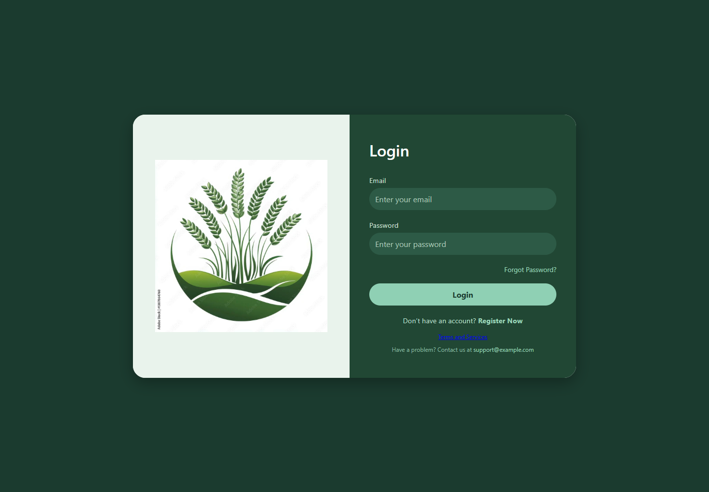

Email and password sign-in. Passwords are hashed with bcrypt at 10 salt rounds;
sessions are carried by JWT. A forgot-password flow issues a reset link by email.

### 1.2 Registration

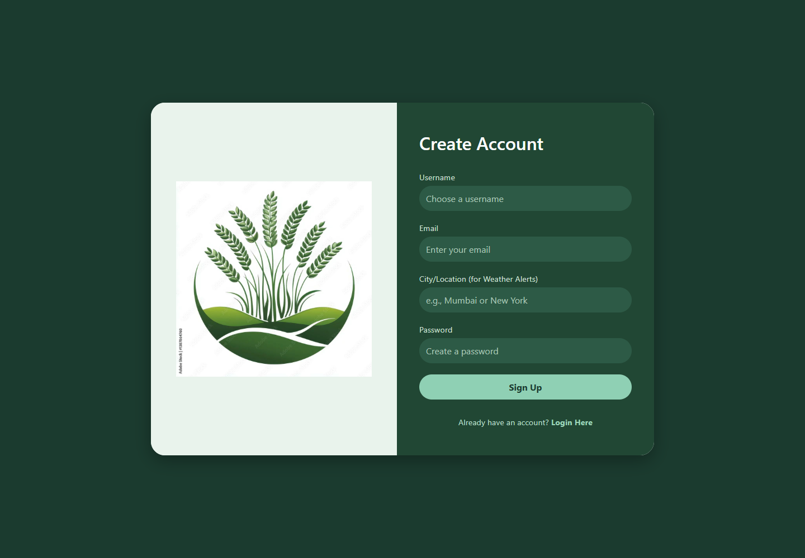

Account creation. The location captured here drives the automated weather alerts
described in §4.

---

## 2. Dashboard

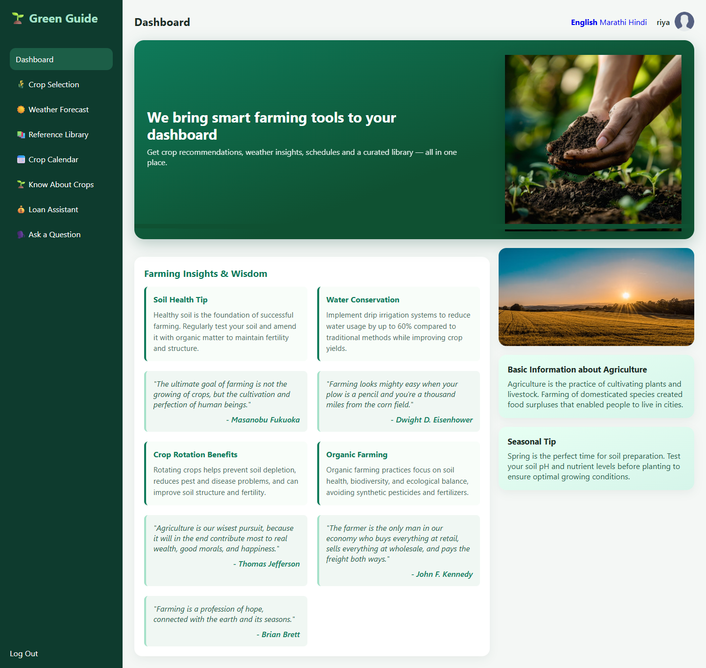

The landing page after sign-in. The left navigation is the app's full feature
set — crop selection, weather, reference library, crop calendar, crop
information, loan assistant and the question interface.

The language switcher (English · Marathi · Hindi) sits in the header, and the
signed-in user is shown at top right.

---

## 3. Ask a Question — the multilingual assistant

This is the application's central feature: a farmer asks in their own language,
by typing or speaking, and receives an answer grounded in the scheme corpus.

### 3.1 The question interface

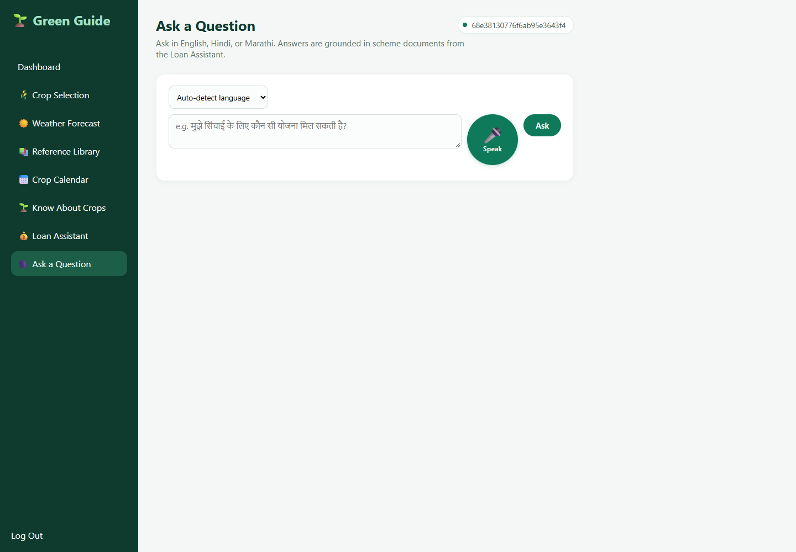

Three controls: a language selector defaulting to auto-detect, a text box, and
the microphone.

**The microphone is deliberately the largest, highest-contrast control on the
page.** The intended user may not be able to read, so the glyph carries the
meaning and the word "Speak" is a label for those who can read it, not the thing
being relied upon. Recording stops on its own after 1.8 seconds of silence, so
no second tap is needed, and the answer plays aloud automatically when the
question was spoken.

### 3.2 A Marathi question answered in Marathi

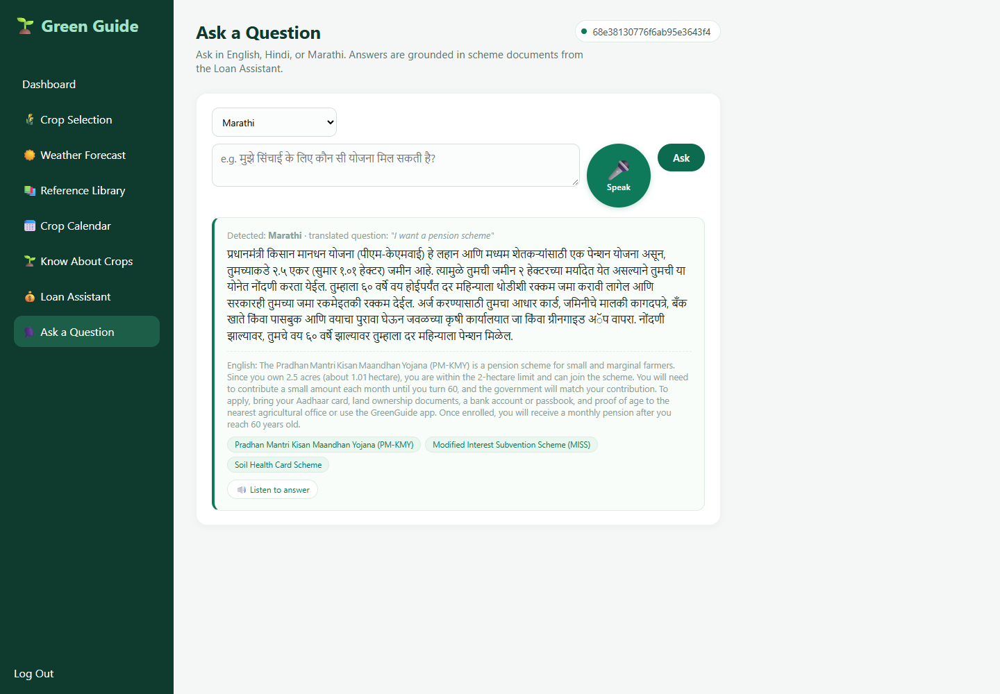

The complete pipeline, visible in one view:

| Stage | Shown in the screenshot |
|---|---|
| Language detection | **Detected: Marathi** |
| Translation to English | *"I want a pension scheme"* |
| Retrieval | Three source chips at the foot of the answer |
| Generation | Answer grounded in the retrieved schemes |
| Translation back | Full answer rendered in Marathi |
| Voice output | **Listen to answer** button |

The answer identifies PM-KMY as the pension scheme and is **personalised to this
farmer's actual land record** — it cites her 2.5 acres (1.01 hectares), confirms
that this falls within the 2-hectare limit, and lists the documents she needs.
The English original is kept visible beneath for verification.

### 3.3 Out-of-scope questions are declined

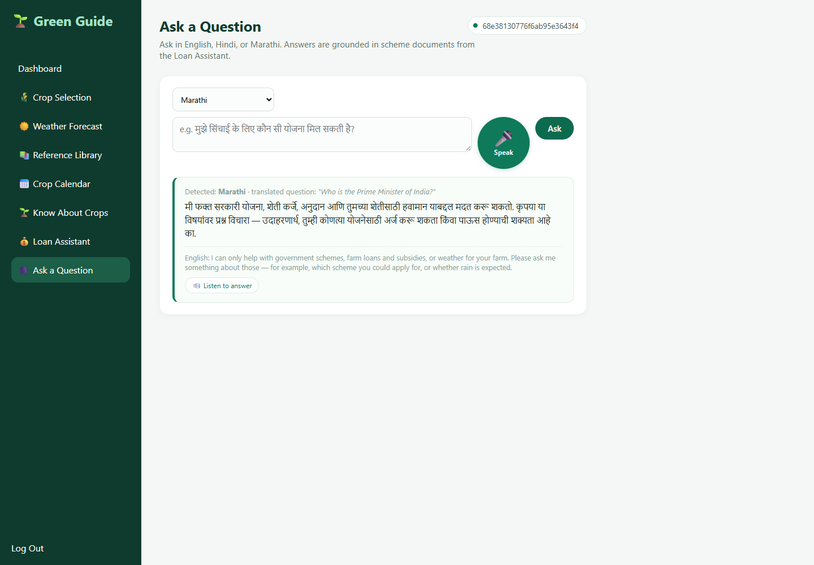

Asked "भारताचे पंतप्रधान कोण आहेत?" (Who is the Prime Minister of India?), the
assistant declines — **in Marathi**.

The application answers questions about government schemes, loans and subsidies,
or weather, and nothing else. That boundary is enforced in code before the
language model is called, not by prompt instruction, so it cannot be argued
around and does not depend on an API call succeeding.

---

## 4. Weather

### 4.1 Search

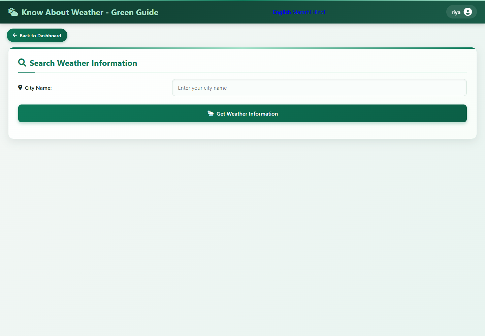

### 4.2 Live results

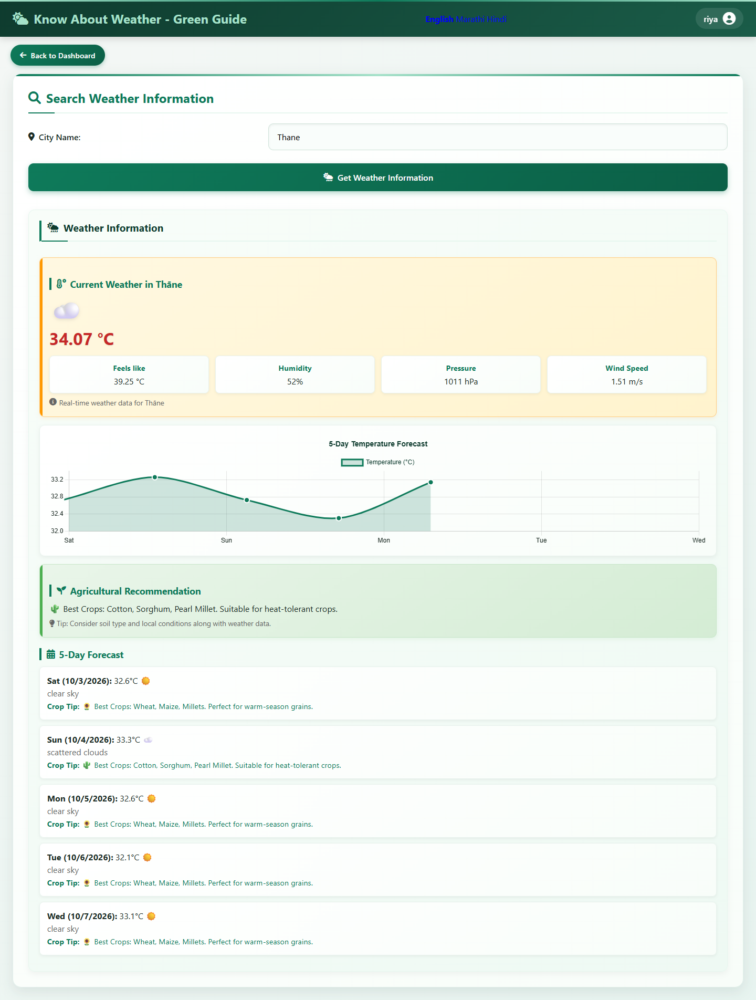

Live data from OpenWeatherMap for Thāne: current temperature, feels-like,
humidity, pressure and wind speed, a five-day temperature chart, and a day-by-day
forecast.

Each day carries a crop recommendation derived from its conditions — the warm
clear days suggest wheat, maize and millets, while the 33.3 °C scattered-cloud
day suggests heat-tolerant cotton, sorghum and pearl millet.

A scheduled job also emails weather alerts to farmers who have saved a location.

---

## 5. Loan & Scheme Assistant

### 5.1 The three-step flow

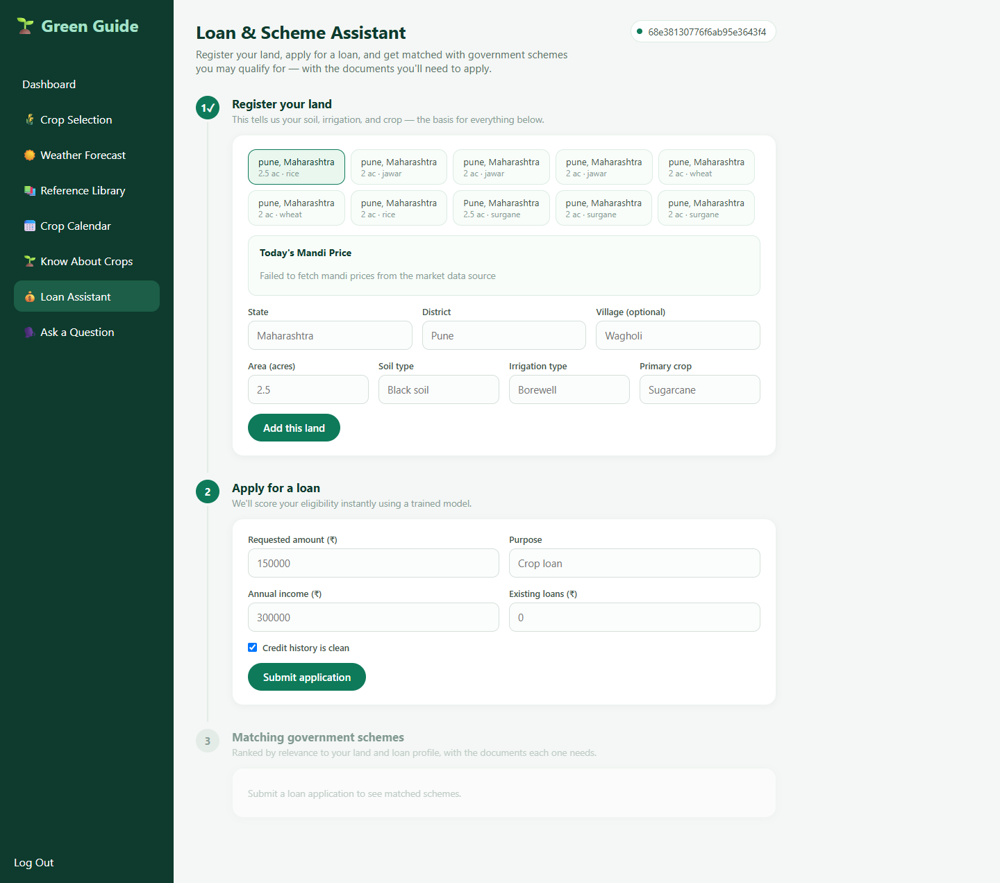

Land registration, loan application, and scheme matching. The ten chips at the
top are this account's real registered parcels, each showing location, area and
primary crop. Selecting one fills the form beneath it.

### 5.2 Eligibility scoring and matched schemes

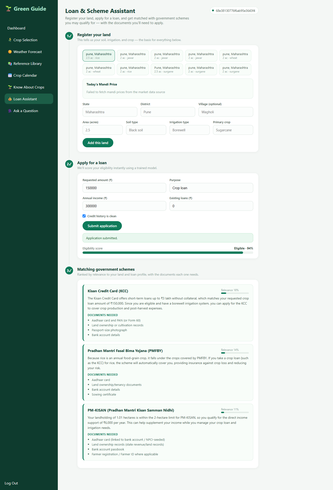

After submitting an application for ₹150,000 against ₹300,000 annual income:

**Eligibility: 94%.** This comes from a logistic-regression model trained offline
in scikit-learn, with the weights exported to JSON so scoring at runtime is a
single dot product and a sigmoid — deterministic, instant, and explainable. It is
not a language-model judgement.

**Three schemes, ranked by relevance** — Kisan Credit Card (18%), PMFBY (14%),
PM-KISAN (11%). Each carries a plain-language explanation tied to this farmer's
actual circumstances ("matches your requested crop loan amount of ₹150,000",
"your landholding of 1.01 hectares is within the 2-hectare limit"), followed by
the exact documents required to apply.

Ranking uses TF-IDF retrieval over the scheme corpus. Measured across 1,440
synthetic farmer profiles, the system achieves **91.0% top-1 accuracy and 100%
top-3 recall** — since three schemes are shown, the correct one reaches the
farmer every time.

---

## 6. Crop planning

### 6.1 Crop selection

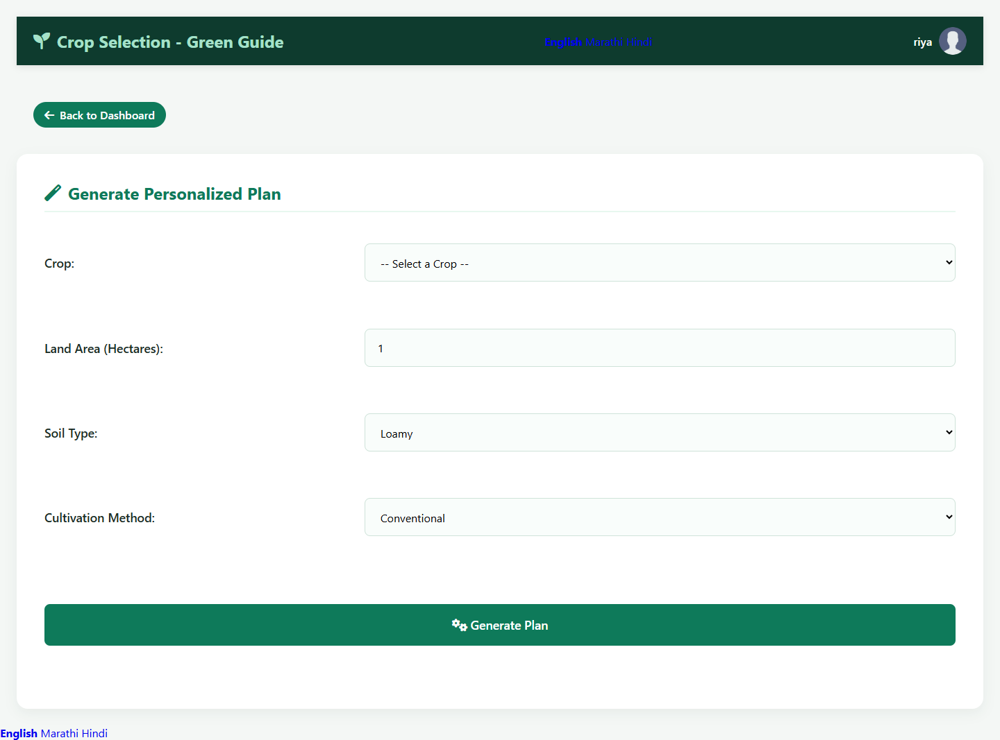

Generates a personalised cultivation plan from four inputs — crop, land area in
hectares, soil type and cultivation method (conventional or organic).

### 6.2 Crop calendar

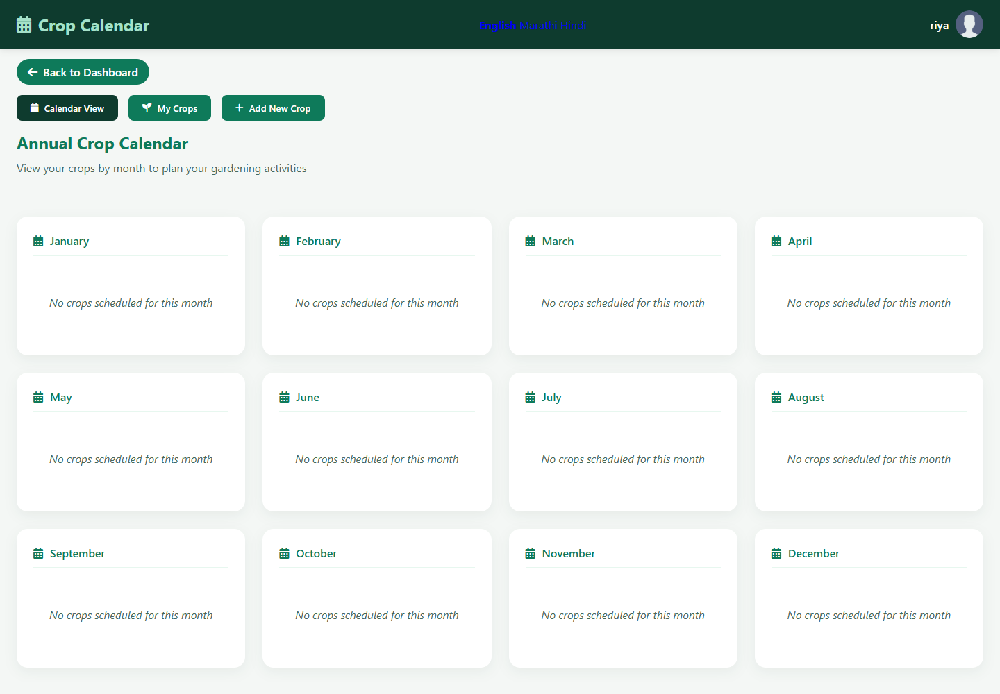

A twelve-month planning view. Crops added through **Add New Crop** appear against
the months they are scheduled for; this account has none added yet, so every
month reads "No crops scheduled for this month".

### 6.3 Know About Crops

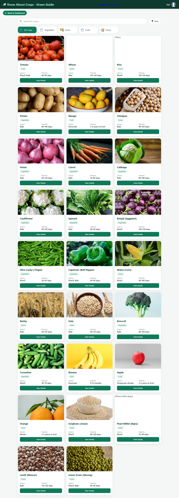

A browsable catalogue of 26 crops, filterable by vegetables, grains, fruits and
pulses, with a search box. Each card carries the growing season (Kharif, Rabi,
perennial) and days to maturity — Wheat 110–130 days (Rabi), Okra 50–65 days
(Kharif), Banana 9–12 months — with a detail view behind each one.

### 6.4 Reference library

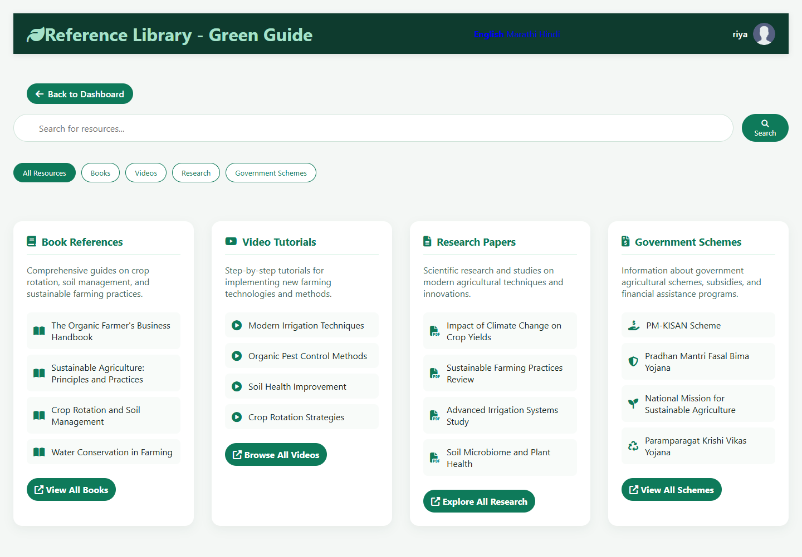

Curated reference material in four categories — books, video tutorials, research
papers and government schemes — with a search box and category filters.

---

## 7. What these screenshots demonstrate

| Claim | Where it is visible |
|---|---|
| Multilingual input and output | §3.2 — Marathi question, Marathi answer |
| Retrieval-grounded answers | §3.2 source chips; §5.2 ranked schemes |
| Personalisation from real records | §3.2 and §5.2 both cite the 2.5-acre holding |
| Scope enforcement | §3.3 — off-topic question declined in Marathi |
| Machine-learning scoring | §5.2 — 94% eligibility from the trained model |
| Live third-party integration | §4.2 — current conditions and forecast |
| Accessibility for non-readers | §3.1 — large mic, auto-stop, automatic speech |

---

## 8. Honest notes

Two things visible in these screenshots are worth stating plainly rather than
cropping out:

**Mandi prices fail to load** (visible in §5.1 and §5.2: *"Failed to fetch mandi
prices from the market data source"*). The data.gov.in market-price endpoint is
not returning data for these parcels. The feature is implemented and the failure
is handled gracefully, but it is not working at the time of capture.

**Spoken Marathi output falls back to English.** Windows 11 Home Single Language
offers no Marathi text-to-speech voice — confirmed by querying the system's
available language packages. Marathi *text* answers are unaffected and correct;
only the spoken layer falls back, and when it does the interface says so rather
than reading Devanagari with an English voice.

---

*Captured 2 October 2026 from the running application.*
